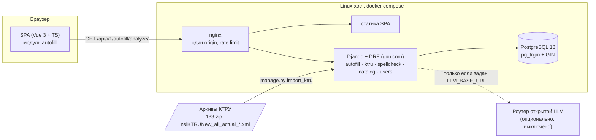

# Архитектура

Модульный монолит: один процесс на бэкенде и одна сборка на фронте, но внутри — независимые
модули, и каждый разрезан на четыре слоя.

## Компоненты



Наружу открыт один порт — nginx. Бэкенд и статика общаются по внутренней сети, поэтому с точки
зрения браузера это **один origin**: сессионная cookie своя, CORS не нужен, `SameSite=Lax`
достаточно.

Схема процесса подбора — [`ALGORITHM.md`](ALGORITHM.md) и
[`diagrams/autofill-bpmn.svg`](diagrams/autofill-bpmn.svg).

## Слои

Зависимости направлены **внутрь**: наружный слой знает о внутреннем, обратное запрещено.

```
presentation  →  application  →  domain
      ↓               ↑
 infrastructure ──────┘   (реализует порты, объявленные в application)
```

| Слой | Что внутри | Чего там быть не может |
| --- | --- | --- |
| `domain` | сущности, правила, пороги, ошибки | Django, DRF, HTTP, Vue |
| `application` | сценарии, порты, DTO | ORM, `fetch`, сериализаторы |
| `infrastructure` | ORM-модели, репозитории, шлюзы, миграции | бизнес-правила |
| `presentation` | views, сериализаторы, URL, компоненты | бизнес-правила, запросы в БД |

Почему именно так — на примере этого проекта:

* **Правила тестируются без фреймворка.** `backend/tests/test_matching.py` и
  `test_autofill.py` не просят фикстуру `db` и не поднимают Django. Весь алгоритм сужения —
  190 тестов — выполняется за шесть секунд, поэтому его можно гонять после каждой правки
  порога. Если бы `AnalyzeDescription` ходил в ORM напрямую, каждый такой тест требовал бы
  базы с импортированным КТРУ.
* **Пороги лежат там, где их обосновывают.** `NAME_OVERLAP_FLOOR` — в
  `autofill/domain/matching.py`, рядом с замерами, которые его оправдывают, а не в SQL-запросе.
* **Границы видно в импортах.** `from django...` в `domain` — нарушение слоя, заметное в ревью
  без запуска кода.

Единственное место, где всё соединяется, — композиционный корень:
[`backend/config/container.py`](../backend/config/container.py) и `frontend/src/app/main.ts`.

## Модули бэкенда

| Модуль | Отвечает за | Зависит от |
| --- | --- | --- |
| `autofill` | разбор описания, сужение КТРУ, проверка значений | `ktru`, `spellcheck` (через порты) |
| `ktru` | справочник: парсер XML, модели, единицы, конверсия, словарь | — |
| `spellcheck` | раскладка, опечатки, опциональная LLM-стадия | порт `VocabularySource` |
| `catalog` | демонстрационный поиск по товарам | `spellcheck` |
| `users` | регистрация, вход, сессия | — |

`autofill` не импортирует ORM-модели `ktru`: он объявляет порты `KtruCatalog`, `QueryCorrector`,
`UnitNormalizer` в `application/ports.py`, а `container.py` подставляет реализации. Поэтому
весь алгоритм можно прогнать на заглушках в памяти — что тесты и делают.

## Модули фронтенда

Те же слои, те же правила. `frontend/src/modules/autofill/`:

| Файл | Слой | Отвечает за |
| --- | --- | --- |
| `domain/analysis.ts` | domain | типы разбора, серьёзность проблем, согласование числительных |
| `application/autofillStore.ts` | application | состояние, дребезг ввода, отмена запросов |
| `application/ports.ts` | application | порт `AutofillGateway` |
| `infrastructure/httpAutofillGateway.ts` | infrastructure | единственное место, где есть `snake_case` бэкенда |
| `presentation/*.vue` | presentation | экран и его панели |

### Одно состояние: текст описания

Источник истины — **текст в поле**. Всё, что делает пользователь — принимает исправление,
нажимает подсказку, уточняет характеристику, — редактирует этот текст, после чего описание
разбирается заново.

Это важнее, чем кажется. Альтернатива — держать отдельный список «подтверждённых
характеристик» рядом с текстом — создаёт два состояния, которые расходятся: пользователь
правит описание руками, а список остаётся от прошлого разбора. При одном источнике
«поэтапное сужение при вводе характеристик» работает одинаково, печатает ли пользователь или
нажимает подсказку, а API остаётся **без состояния**: один `GET`, который можно повторить,
закэшировать и которым можно поделиться ссылкой.

## Как добавить ещё один модуль

1. `backend/apps/<имя>/{domain,application,infrastructure,presentation}/`;
2. правила — в `domain`, сценарий — в `application/use_cases/`, порты — в
   `application/ports.py`;
3. реализации портов — в `infrastructure`, сборка — в `config/container.py`;
4. `path(f"{API_V1}<имя>/", include("apps.<имя>.presentation.urls"))` в `config/urls.py`;
5. тесты на домен и сценарий — без `db`, на заглушках.

Во фронтенде — зеркально: `src/modules/<имя>/` с теми же четырьмя папками и маршрут в
`src/app/router.ts`.

## Масштабирование

Что уже сделано и чем ограничено:

* **Поиск.** GIN-индекс `gin_trgm_ops` по `ktru_position.name`. Сортировка по сумме сходств
  индексом не покрывается, поэтому при росте справочника до полных 60 087 активных позиций
  понадобится предфильтр оператором `%` (он индексируется) до ранжирования. Сейчас, на 1812
  позициях, медиана 39 мс.
* **Процессы.** Бэкенд без состояния между запросами, сессии в БД, `GUNICORN_WORKERS`
  масштабируется горизонтально без липких сессий.
* **Индексы корректора.** Единственное, что кэшируется на процесс (`lru_cache` в
  `container.py`): каждый владеет построенным в памяти индексом по всему справочнику, и
  перестройка на запрос стоила бы дороже самого поиска. После изменения справочника —
  `reset_spelling_indexes()`.
* **Чтение КТРУ.** Одним запросом с `prefetch_related` на весь пул кандидатов; N+1 на
  трёхстах позициях определял бы всё время ответа.
